# Mechabellum vision

> **Warning.** This is a research project. Results hold only for the recordings they were measured on (stated with
> each result). The demo is a real game recorded under conditions set in advance to avoid known problems;
> **it is not general accuracy**.
> Everything was done on **one map**; nothing can be claimed for other maps until tested.
> The research code is private; the demo is available on request.

**Main demo** — C8 + K15 mask, then the spiders found and tracked — the Tarantula unit (demo recording, 1.2× speed):

https://github.com/user-attachments/assets/f7643624-28b4-4f76-bd8e-fdd918a8550e

**Final result** — every spider found and tracked through the demo recording (green box = spider, J# = unit number):

https://github.com/user-attachments/assets/86975e28-954b-4210-a49c-8fd620452f3f

## Intent

The long-term goal is an AI that plays the game. That needs two layers: **vision** (what is on the screen), if the
game has no other interface to its data, and **reasoning** (what to do). This project explores vision only.

We do not yet know exactly how the result will be used; we explore how much can be extracted from the screen image
alone, without major complications. Two possible uses:
1. classical algorithms (no neural network) that recognise units on the image by themselves;
2. collecting a large labelled dataset to train a neural network or other machine-learning algorithms.

The approach is **weak supervision with a human in the loop**: the system generates the labels itself and a human
only confirms something now and then (e.g. picks once which clusters are units) instead of labelling images by hand.
These labels can serve as templates for iterative refinement of the system.

## Problem

From a screen recording of Mechabellum (no access to game data), find where the units are and track them through the
battle. Main goal: **know where a unit is for as much of the time as possible**, so it can be clicked at any moment
and its positions can be used for further learning.

## Step by step

| # | Step | Chosen |
|---|---|---|
| 1 | where does something move | C8 mask |
| 2 | first clustering attempts | boxes, HOG with a floor filter (abandoned) |
| 3 | which of it is a unit | K15, clusters 2, 6, 13 |
| 4 | where is the camera on the map | two markers on screen → zoom + shift |
| 5 | how units move | *(in preparation; not used by the demo)* |
| 6 | where exactly is this unit, and where does it go | cascade: template → objects → tracking → local search |

## 1. First layer — where does something move

Before anything can be selected, a main filter is needed: what moves on the map, as a basic identification of units.

**Tried: 18 combinations of 14 basic operations** — colour mask + contours, colour mask + edges, blob size,
brightness projection, colour quantisation, optical flow + edges (5 variants), battlefield only, saturation,
difference heat map, background subtraction, per-team flow. Combinations with edges (Canny) were also in the running.
All variants one by one: [inacice_587.mp4](demo/c8/inacice_587.mp4)

All variants on one frame of the first dataset

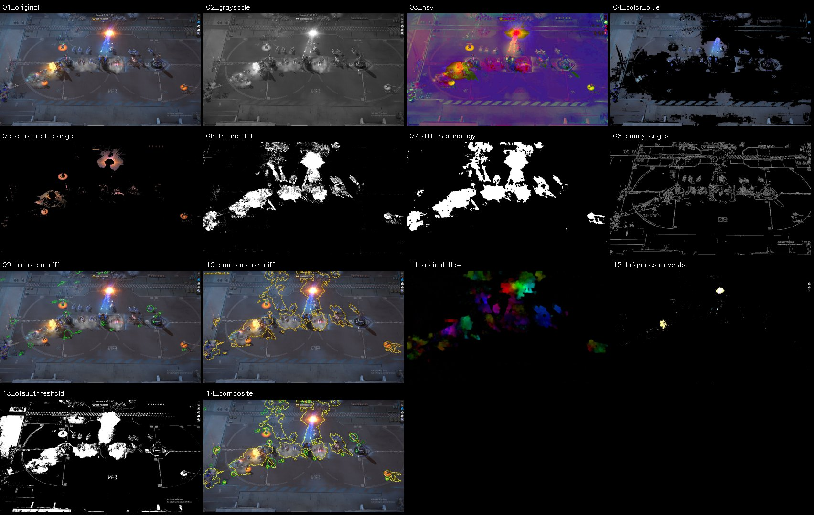
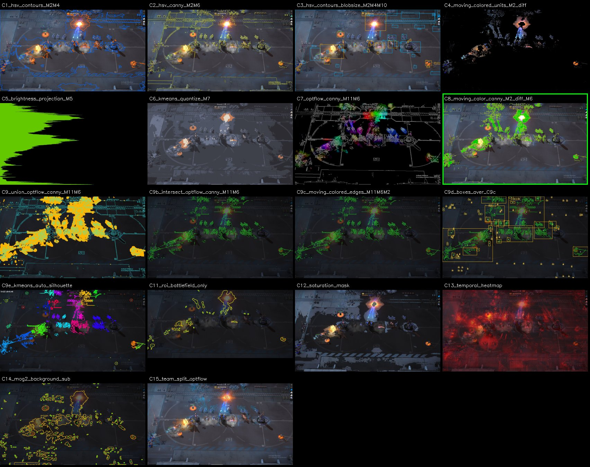

**Chosen: the C8 mask** — it combines two things: team colour and change from frame to frame. A pixel is in the mask
if both hold:
1. **team colour** (HSV): blue (hue 90–130) or red (hue 0–15 or 160–180), with saturation ≥ 50 and value ≥ 50
   (of 255);
2. **change:** the grey value of the same pixel differs by more than 20 (of 255) between frame n and the frame one
   second later.

Finally the mask is "closed" (morphological closing, 7×7 px ellipse): small holes and gaps inside a unit are filled,
so the whole unit is covered by the mask, not just scattered pixels.

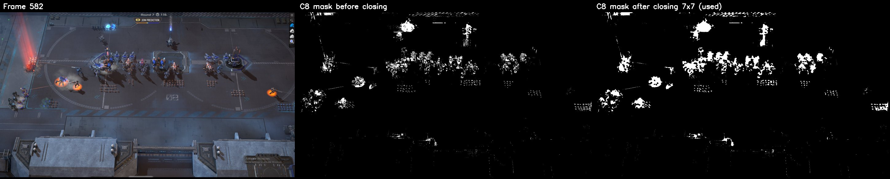

In the C8 video and in the variants picture ("C8_moving_color_canny") the same mask is painted green over the frame,
and its Canny edges are yellow — the edges are for display only, they are not part of the mask.

**Why C8:** of the combinations tried, it is the only one that catches almost all units and drops floor and UI,
with no training and no labels. The thresholds (20, 50, hue ranges) were chosen by eye, not measured.

It works in most cases and everything else builds on it. Sometimes it misses a unit standing still; it also catches
wrecks, fire and explosions; when the camera moves, team-coloured floor enters the mask. The next steps clean this up.

## 2. First clustering attempts — before K15

The C8 mask captures two things — team colour and motion between frames. The aim was to cover all units, and on the
first dataset that mostly worked. But many false positives remained: floor and other elements that have the team
colour and change between frames. The first attempts — grouping the mask into boxes, then HOG with a floor filter —
keep most units with little extra on the first frame, but on the following frames many boxes stay on the floor.
So we moved to 10×10 squares and K15.

Video: [prije_k15.mp4](demo/prije_k15.mp4)

## 3. K15 — which of it is a unit

**How:** the mask is split into 10×10 px squares. Each square is described by 12 colour-free numbers (brightness,
spread, edge strength, edge directions sorted from the strongest, so the description does not depend on rotation).
K-means with 15 clusters, trained on the first dataset; clusters 2, 6 and 13 are "unit".

**Training and check:** K-means was trained on the even frames 580–622 of the first dataset, checked on the odd
frames 579–621 **of the same dataset**, and then applied without retraining to **two new datasets**. On both new
datasets it keeps almost all of its quality (**observed**, not counted) — with the caveat that all three datasets are
from **the same map**. The mask shows that it mostly does not mark the floor, while it marks units, wrecks and gunfire.
Key point: it marks units **completely** — almost nothing of a unit is dropped. Wrecks and gunfire are filtered in the
following steps. Caveat: on some frames the floor is not removed completely.

**From C8 to the unit mask, step by step:** frame → C8 mask → 10×10 squares with at least half C8 pixels → each
square gets its K15 cluster → clusters 2, 6, 13 kept → outline of the unit mask on the frame.

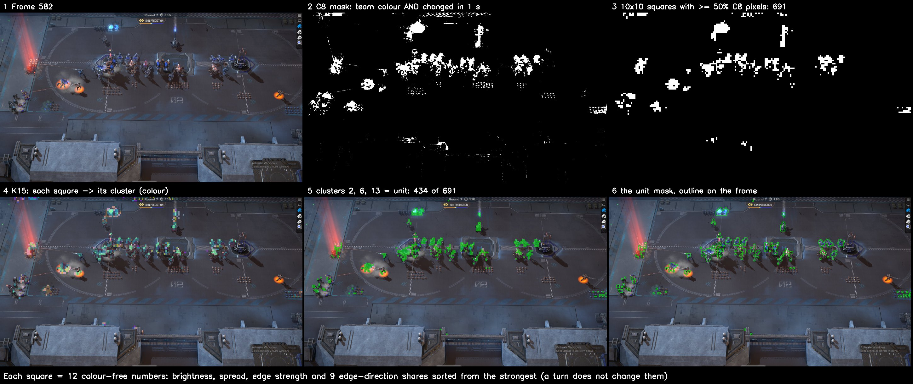

**Idea: as little manual work as possible.** K-means splits the squares into 15 clusters by itself, without labels
(*unsupervised*). A human looks at the 15 clusters once and says which are units — the only manual input (*lightly
supervised*; cluster first, then label). Picking 3 of 15 clusters gives a unit mask on every frame without labelling
a single image. These are not yet labels of individual units, but a label "this square belongs to some unit". These
labels feed the next steps and could later be used to train a detector (YOLO or a neural network) — **not tested**.

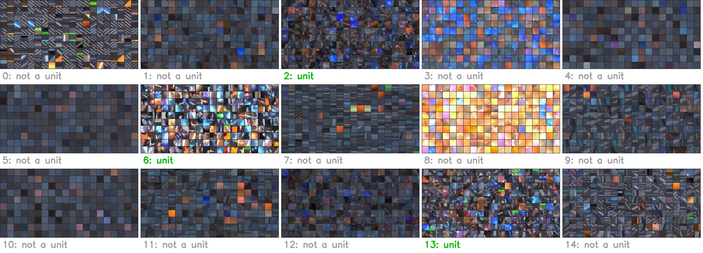

## 4. Camera — where the view is on the map

**Two coordinate systems:**
- **screen** — pixels of the recorded frame (1920 × 1080). When the camera moves or zooms, everything on screen
  moves, including what stands still;
- **map** — the fixed coordinate system of the battlefield, tied to markers on the floor (origin = our left tower).
  A unit standing still has the same map position regardless of the camera.

The camera links the two: zoom and shift for every frame, so every screen pixel can be moved to the map. Units are
tracked on the map, not on the screen.

**Idea: again as little manual work and manual labelling as possible.** The map has fixed, recognisable parts: two
towers per side (main markers), plus helpers — the side number (01 / 02) and the signs A and B. These markers were cut
out by hand once (7 small images); nothing is labelled per frame.

**How:** on every frame two markers of the same side are searched for — usually the two towers; if a tower is not
visible, tower + number, tower + sign or number + sign. **Two markers are the minimum**: from their screen positions
and their known map positions (measured once, from 81 frames of the first dataset) we compute
screen = zoom × map + shift. The camera position is the map point at the centre of the screen.

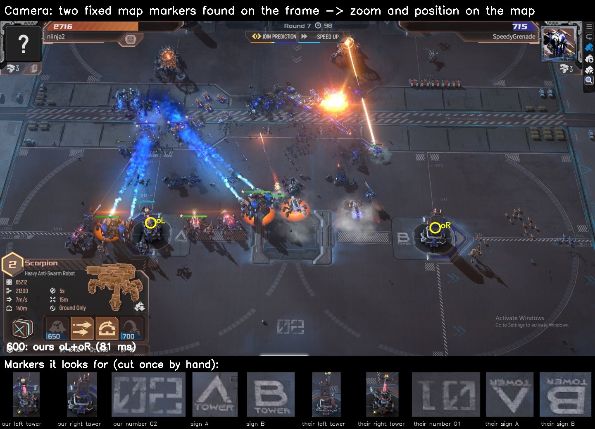

**Check:** once two markers are found, their positions are compared with the known marker positions on the map.
Frames that fit much worse than the others are searched again with other markers (side number + sign).

**How many frames have a camera:** when the camera is found it is almost always right (median error 1–1.3 px; up to
~3 % of frames with a camera are outside 2 σ of the median).

| Dataset | Frames | Frames/s | Camera found |
|---|---:|---:|---:|
| first dataset — a real game against another player; the approach was developed on it | ~600 | 1 | 100 % (93 % two towers, 7 % with helper markers) |
| second dataset, battle segment (template, cascade) | 200 | 5 | 100 % |
| third dataset, battle segment (methods tried) | 633 | 5 | 82 % |
| demo — camera deliberately moved little | 261 | 5 | 100 % |
| **worst case:** the whole second dataset (estimate: 2–3 games) | 11 055 | 5 | 44 % |

In the worst case everything was recorded: frequent and large camera moves during preparation, loading screens,
the interface between rounds — frames where the floor is not visible (likely causes, not checked). On the battle
segments we measured, the camera was found on more than 80 % of frames. We believe it can be higher, but this holds
only for our measurement; the real figure would need a larger sample, different maps and other variables.

**Why:** without a camera, frames cannot be compared over time — when the camera moves, everything on the frame
"moves".

We did not go into a deeper analysis of camera reliability. It would need checks on other maps and maybe other anchors
or another way of anchoring the frame, not only through the towers. Note also that in the game the camera can rotate
around the vertical axis, while the model (zoom + shift) has no rotation: the marker positions on the map were measured
with a tilt of ~0.8°, the demo recording is level (0°), so the demo keeps a constant ~6 px vertical error (horizontal
0.1 px); for tracking this constant part cancels out between neighbouring frames. A model with rotation, larger turns
and perspective were not tested. The point is that the camera is good enough for the other steps, as it turned out —
without it tracking would not work. It holds for the case described here (see "How representative is this").
A more robust camera (rotation, other maps) is future work.

## 6. Cascade — where exactly is this unit, and where does it go

**Template — how we got the image of one spider** (second dataset)

Goal: one clean image of a spider, without floor and without the legs that keep changing, to find the others with.

The whole procedure as a video (≈1.5 min): [predlozak_postupak.mp4](demo/predlozak/predlozak_postupak.mp4) —
the step-by-step description and pictures are below.

1. **Find one unit.** On one frame the mask cluster (K15) of one spider is taken and followed through the next frames.
   A rectangle is drawn around it on every frame.
2. **Align it.** Every rectangle is turned and shifted to best fit the rectangle from the middle of the run. Now the
   same part of the spider is at the same place on all frames.
3. **Keep only clean frames.** Where the fit suddenly breaks, something else is next to the spider (a neighbour, an
   explosion, a camera jump). The unbroken run without that is kept: 54 frames (~11 s).
4. **Measure what moves with the spider.** The rectangle is split into 10×10 squares and for each we measure how far
   it moves to the next frame. Spider speed = median of all squares. A square that moves differently (legs, floor)
   deviates from that speed.
5. **Draw the body.** Thanks to step 2, the deviation is averaged over 54 frames for every place on the spider. The
   line where the deviation is at most 3 px/s bounds the body — the part that always moves together with the spider.
6. **Pick the most typical frame.** Of the 54 frames, the one most similar to all others (the medoid) is taken and cut
   along the body line. That is the template.

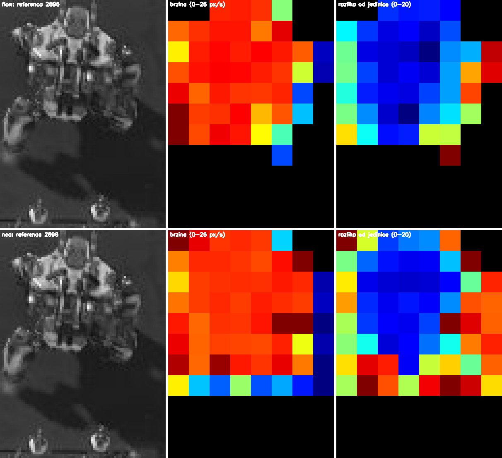
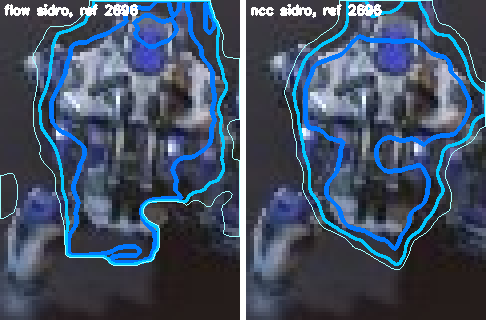
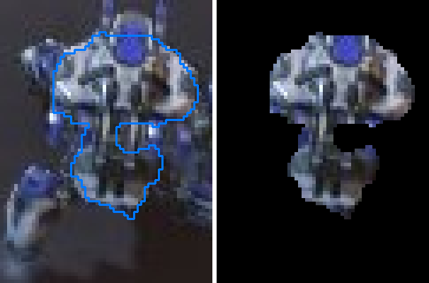

Secondary: other template shapes tried

**Other template shapes tried** (same medoid, different choice of pixels): body only without the box (the first
shape); the whole box; isohypses — lines of equal brightness rank (independent of brightness and contrast), taken
inside the 0.7 isohypse; a share of the brightest box pixels (50 % and, after blurring, 40 %). In the floor control
the body alone separated best (d′ 9.3–9.8 vs 7.4–9.1 for the brightest 50 % and 6.7–8.1 for isohypses).
Videos: [body vs isohypses](demo/pristupi/core2_cisto_rang.mp4), [other approaches tried](demo/pristupi/pristupi.mp4)

**How the template is compared with a place on the frame**

Comparison methods tried:

| # | Method | What it does |
|---|---|---|
| 1 | ECC | fine alignment by shift and angle, equalises brightness and contrast itself |
| 2 | ICP 3D | pixels as 3D points (x, y, brightness) |
| 3 | slope direction | where brightness rises, pixel by pixel |
| 4a | Fourier spectrum | kinds of patterns regardless of where they lie |
| 4b | Fourier phase | shift and peak strength, in one go |
| 5 | Fourier phase → ECC | Fourier finds the shift, ECC refines it |
| **6** | **composite** | mean of 4b, ECC and slope direction |
| **7** | **any angle** | 4b over all angles, score = slope direction |
| 7b | ±5° | same as 7, only ±5° |

For this case **7 and 6** were chosen. These and many others (NCC variants, LoG, blur, composites) were tested
extensively.

**Method 7 — a broad search over both angle and position inside every possible match.** The template is turned every
10° (0–350°). For each angle, Fourier phase correlation gives in one step where the template fits best (the shift).
Around the best angle ±5° in 1° steps is searched as well. The score is the **agreement of brightness slope
directions**: for every pixel we look at the direction in which brightness rises and compare it with the direction in
the template. Score 1 means the same directions, 0 means no relation. Direction does not depend on brightness or
contrast, so lighting does not change it.

**Composite 6 — a check at that angle.** Once method 7 gives the angle and place, the same place is scored by three
measures and their mean is taken:
- Fourier phase: do the shapes (edges) match, regardless of brightness;
- ECC: how well the images match when the template is refined a little more (shift and angle);
- slope direction: as in method 7.

<b>Method 7 and composite 6 step by step (one frame, three possible matches)</b>

Example: frame 2700 of the second dataset.

**Where we search.** The template is not searched over the whole frame, only inside the unit mask (C8 + K15, pink).
Touching mask squares form a piece; a window of template size is placed around each piece (larger pieces get a grid
of windows). Every window is a **possible match** — 98 on this frame. Method 7 scores each of them.

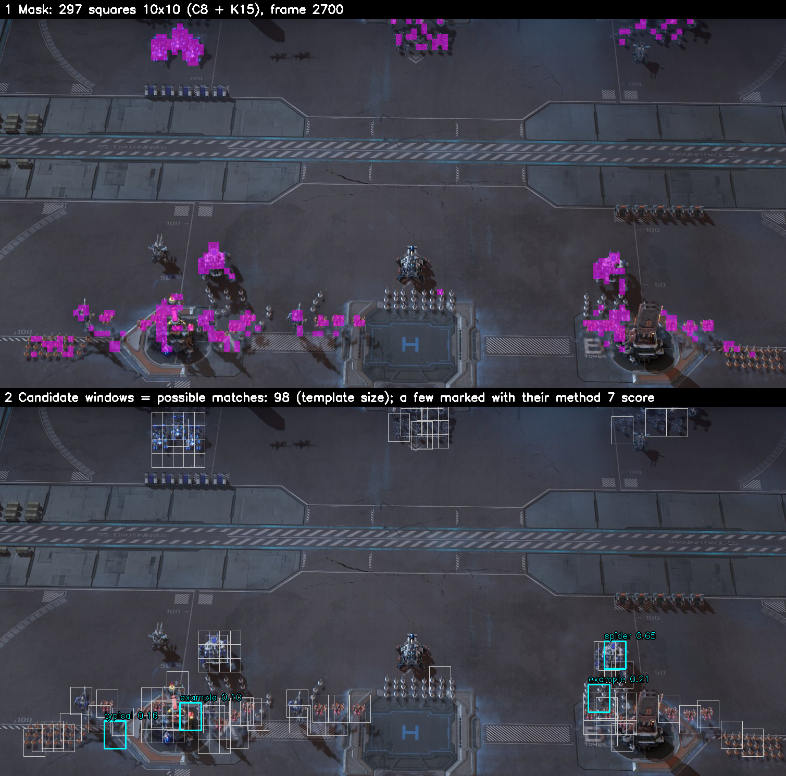

Three of them are followed: the spider (best score), #97 (passes method 7, filtered by composite 6) and a typical one
(median score, already fails method 7).

**Method 7**

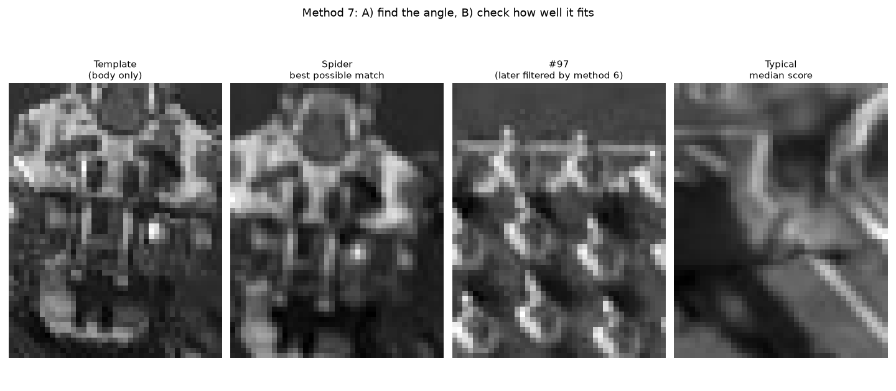
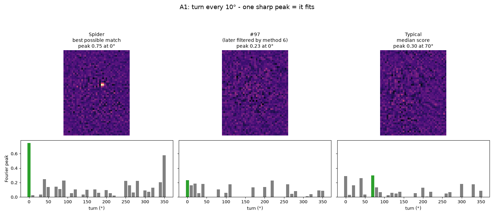
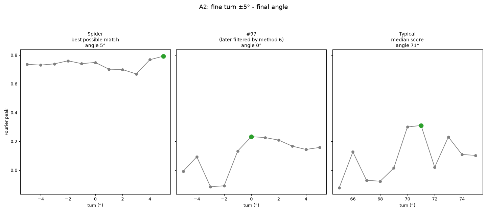
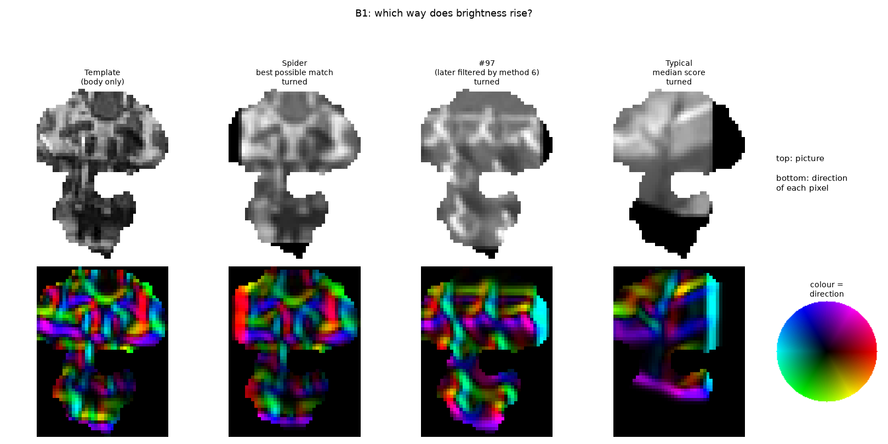
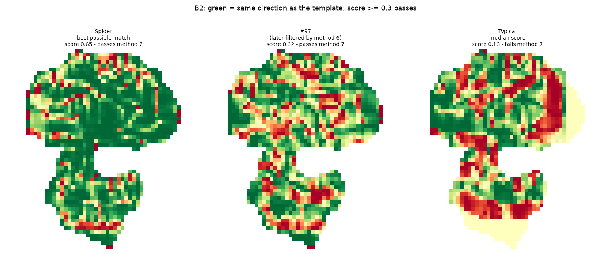

**Composite 6**

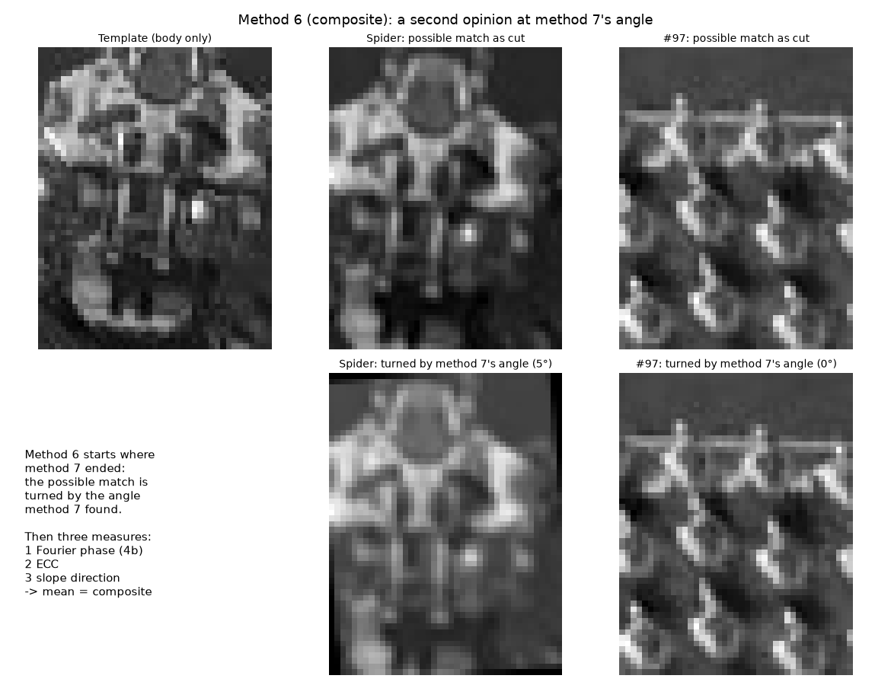
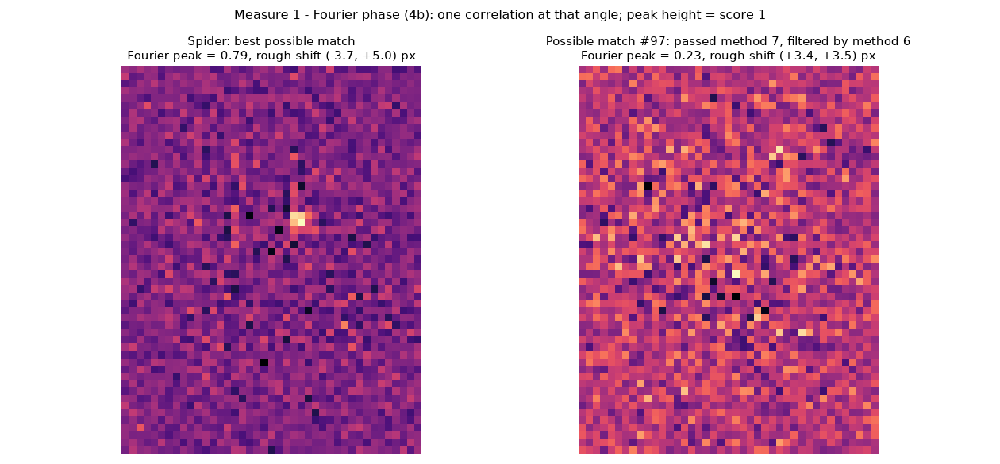
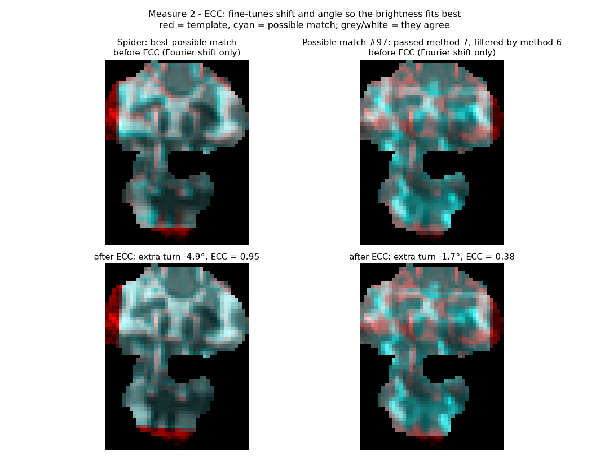
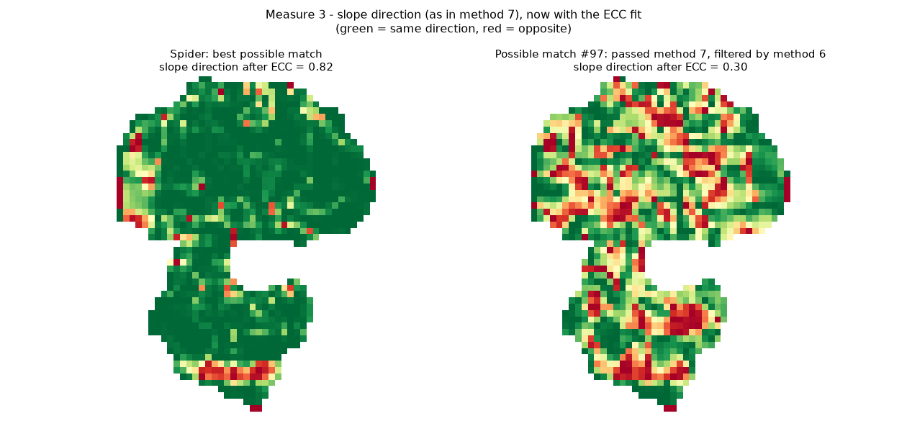
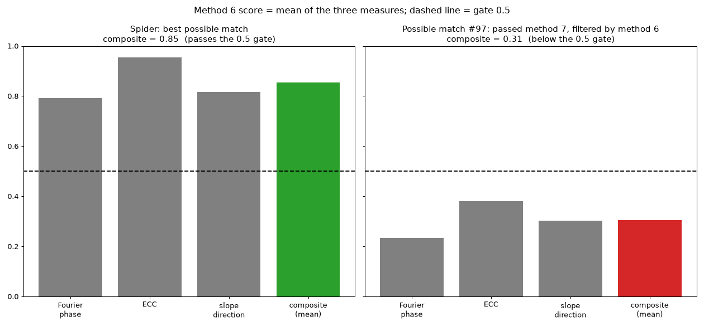

One measure can by chance give the floor a high score, but three different ones rarely fail together (**observed**,
not counted).

**How:** on every possible match from the mask:
1. **method 7 — broad search** over angle and position: Fourier phase over all angles (every 10°, then ±5° in 1°
   steps) gives angle and shift; score = agreement of brightness slope directions; gate 0.3
2. **method 6 — fine check** at the angle method 7 found: ECC refines shift and angle a little more, and the score is
   the mean of three measures (Fourier phase, ECC, slope direction); gate 0.5. It removes what method 7 let through by
   chance.
3. **objects** — overlapping boxes on the same frame = one object
4. **tracking** — linking objects across frames into one unit, by this rule: an object is linked to the next frame
   (camera cancelled, at most half a unit width, may skip 1 frame); a track of at least 5 frames = a unit, shorter =
   dropped
5. **local search** — when a unit is defined by tracking but missing on some frame (a gap in the track), that place is
   checked by these rules: one window at the predicted place, angle ±5°, lower gates (0.25 / 0.45); stops after 8 misses

**Why:** a strict filter — the aim is that every label is right, not that every unit is labelled. Such labels serve the
next round (training a network, tracking, methods for turned units).

The gates 0.3 (method 7) and 0.5 (composite 6) were tuned on the second dataset, which had only two spiders, and
carried over to the demo recording unchanged. The demo is the same map but with many more spiders (up to 7 at once,
median 5 per frame). With more units, an equally high level of correct labels was obtained where they should be; the
exception is spiders at a large angle (see Limitations).

The whole procedure on the second dataset (mask → method 7 + 6 → objects, tracking, local search):
[predlozak_204540.mp4](demo/predlozak/predlozak_204540.mp4). Result on the demo recording:
[kaskada_finalni_1510_1770.mp4](demo/kaskada_finalni_1510_1770.mp4)

**Result on the demo recording**

It finds and tracks spiders without labelling any image by hand. The result is the position of every spider on every
frame (green boxes), strictly filtered: a box stays only if it passes method 7 (≥ 0.3), composite 6 (≥ 0.5) and belongs
to a track of at least 5 frames. Better to miss a spider than to label something wrong — so precision is high and
there is almost no noise.

**No green box is off a spider** (checked by eye on all 261 frames of the demo recording, visible in the video): no
boxes on the floor, on other units or on explosions. This is not measured against hand-labelled frames; minor
exceptions are possible, but we did not see any in this video.

**What is missed:** 5–6 of the 7 spiders are seen all the time. Any spider that turns by more than ~20° is lost, but
as soon as it turns back upright it is found again. How much is missed exactly was not counted, but every spider is
labelled at least once during the battle. Other limitations: see "Limitations".

Secondary: comparison with an alternative tried

**Alternative tried (demo dataset):** another template (brightest 40 % of pixels) and, instead of method 6, the mean of
Fourier phase and a blurred image (gate taken from the third dataset). Compared by position (same unit = within half
a unit width), reference = the union of both, since on review all labels are right:

| Variant | Detections | Of the union (1262) |
|---|---:|---:|
| **cascade (chosen)** | 1225 | **97 %** |
| other template + blurred image | 1038 | 82 % |

Comparison video: [usporedba_1510_1770.mp4](demo/usporedba/usporedba_1510_1770.mp4)

## Demo dataset — recording conditions

Conditions set before recording: the same map type and zoom as the second dataset (the template's source), 5 frames/s,
1920×1080, spiders without upgrades, normal spacing between units, with 2–3 other unit types next to the spiders as
distractors. Otherwise it is a real game.

Demo dataset: frames 1510–1770 (261 frames, ~52 s). Done: C8 + K15 mask, camera, cascade.

**Result:** 16 unit tracks, 1225 detections, median 5 per frame (min 1, max 7) with up to 7 spiders on the field;
100 objects dropped as short tracks (on review these are spiders too).

## How representative is this

The recordings are not synthetic battles but real games (the first dataset against another player). Within this frame
they are realistic:
- a map that is used in the game;
- a game of medium length (up to ~10 rounds);
- normal spacing between units.

The covered case is **realistic**: both the game and the way the camera is used are as in a real game, and the camera
was very reliable under these conditions. By our estimate (not measured) roughly 40–60 % of battles look like this.

**Orientation:** the model loses a unit turned by more than ~20°, but in a normal game most units face north–south,
towards the enemy, most of the time. This also depends on the rank of the game: stronger players attack from the side
more often, so units turn more (estimate).

**Transfer from dataset to dataset:** K15 was trained on the even frames of the first dataset and is good on the odd
ones; it showed the same quality on the second dataset (same map, but not all the same units). The cascade gates (the
process that links the same unit between frames) were tuned on the second dataset (two spiders) and carried over
faithfully, unchanged, to the demo recording, where the noise was even lower (it was low on the second dataset too).
Although the demo does not cover every possible case, the realistic cases it covers are covered well.

The demo does not cover the whole range of possible battles. Not covered:
- other maps;
- other units;
- attack directions in which units turn a lot, or units coming from the opposite direction;
- air units flying over ground units and hiding them;
- upgraded units, whose look and mask brightness are partly different.

## Limitations (not covered)

Challenges in labelling itself: the game is 3D, so a unit's look depends strongly on the viewing angle; both the map
and the view can rotate; an upgrade changes a unit's look a little (the template no longer fits). Units are small,
there are many of them, they turn, and the camera moves.

1. units turned at a large angle (3D game; the template holds about ±20°)
2. upgraded units (different look), other unit types and other maps — not tested
3. floor entering the unit mask
4. small units that come in groups
5. zoom changes and camera jumps
6. units standing still
7. short track pieces (< 5 frames) are dropped, so what was right on those frames is lost too
8. on the demo recording several tracks break at the same time around frame 1600 (cause not checked)
